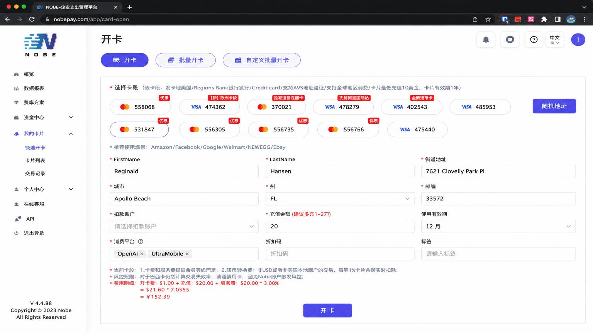
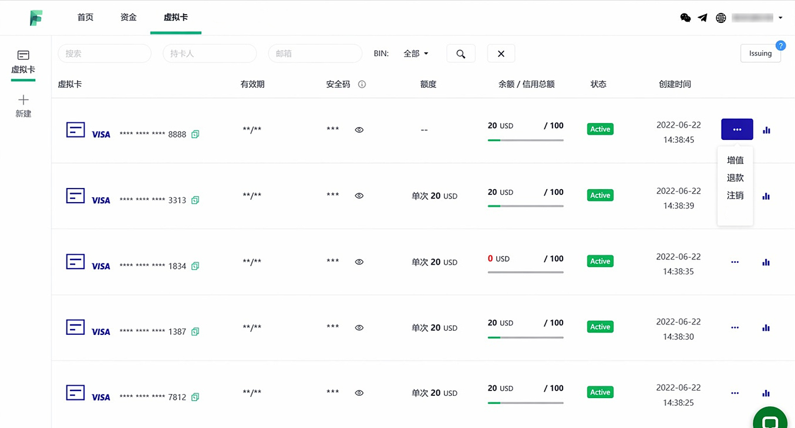

# NobePay虚拟信用卡平替推荐：福田虚拟卡跨境支付指南

## 首先来回顾一下诺贝NobePay虚拟信用卡平台

**NobePay**虚拟卡是2020年—2023年非常火爆的一款美国虚拟信用卡VCC无限开卡平台，我也曾经是NobePay的忠实用户，其美观简洁的开卡平台UI设计，丝滑的开卡流程，真的让人爱不释手，在当年虚拟信用卡行业中绝对算得上“一哥”的存在，达到了其他虚拟卡平台无法企及的高度。这里汇总一下NobePay的一些优点：

- 首先就是它的开卡官网设计，简洁、高效、清爽、丝滑，当年有一些虚拟卡平台设计的非常丑陋，看着都不想用，而NobePay的设计独树一帜，其产品经理的审美绝对有一套。
- 拥有极其丰富的虚拟卡BIN资源。要知道，在那个年代，谁的卡BIN多，谁就能在虚拟卡行业中立于不败之地。且NobePay不光在数量上有优势，质量上也不含糊，拥有很多企业级别的纯正美国卡BIN，这些美国虚拟卡在美国电商平台海淘采购、订阅各种网络服务中表现都很棒，通过率极高，尤其是其支持自定义账单地址功能，用户可根据需要自定义美国账单地址和持卡人姓名，在一些设有AVS地址验证机制的美国电商平台下单购物如履平地，鲜有被砍单的情况发生。
- 充值方式多样。NobePay为了满足用户多元化的充值需求，支持美国银行转账、支付宝、USDT加密货币等方式，网上各种评论无一不叫好的。
- 会员等级制度。用户可根据自己的用卡数量、消耗金额开通不同等级的NobePay会员，不同会员等级在开卡费和充值手续费率方面有不同的优惠待遇，最大程度降低不同用户的用卡成本。
- 采用邀请制注册，平台开户需使用专属的NobePay邀请码，客服会用心服务每一位受邀注册用户，而非全面开放无脑纳新。

NobePay的成功也使得虚拟卡行业如雨后春笋般蓬勃发展，市面上陆续出现了各种大大小小的虚拟卡发卡平台，但服务和产品质量良莠不齐，其中也不乏直接照抄照搬套壳NobePay的山寨货。在激烈内卷的虚拟信用卡行业下半场，NobePay不愿在这乌烟瘴气的市场苟活，终于完成了华丽的转身，转而投向其他新的赛道领域。有人说“NobePay跑路了！”、“NobePay诈骗！”，哪有的事？NobePay的停止服务只是破茧化蝶，以新的方式继续深耕于跨境支付。

## NobePay虚拟卡最佳平替推荐——福田虚拟信用卡平台

如果您当前有跨境电商、Facebook广告投放、Claude人工智能订阅等各种国际在线支付需求的话，不妨试一下**福田虚拟信用卡平台**。福田虚拟信用卡平台与NobePay同于2020年出生，至今已默默运营6年之久，只是没有NobePay名气大而已，但却是唯一能够坚持如此久远的虚拟卡平台了。

福田虚拟卡当前拥有美国、香港、新加坡等地的数十款卡BIN资源，在Facebook广告投放、Claude订阅方面有丰富的支付经验，如果您是从事海外广告营销的或者订阅当下热门的AI人工智能，福田卡绝对是您绝佳的选择。

福田虚拟卡仅需Email邮箱注册，支持USDT充值，无需KYC，免实名认证，在这个电信诈骗猖獗的岁月里，福田卡始终把用户的个人隐私安全放在首位。

相比NobePay，福田虚拟卡有一个独家的“商户查询”功能，即使您是初次使用，不知道选择哪个卡BIN，在开卡页面通过商户查询功能也能精准匹配哪个卡BIN适合您的业务场景，不至于面对琳琅满目的卡BIN抓耳挠腮。

鉴于其他虚拟卡平台均遭受过羊毛党的薅羊毛，导致卡头被撸坏，影响其他合规用户，福田虚拟卡平台有一套保证其卡BIN长久稳定的保证金机制，用户需先支付100美元保证金才能开卡，拒付率退款率达标则可以申请退还保证金。正是这套安全措施，才避免了在羊毛党泛滥的今天不至于像其他平台一样被撸坏，保障了正常用卡客户的切身利益。稳定压倒一切，稳定才是王道！

价格方面，福田虚拟卡拥有相对低廉的用卡成本，虽然不能说价格是最低的，但可以说是最划算的。这年头钱不好挣，福田卡帮跨境老板们节省一点是一点。

平台支持即时退款，如果您觉得平台不好用，可随时联系客服申请退款，退款秒到账！大家都是做生意的，可不敢耽搁老板们的资金周转。

**[立即注册福田虚拟卡平台](https://dashboard.fotoncard.com/#/pages/register?agent=388832)**

